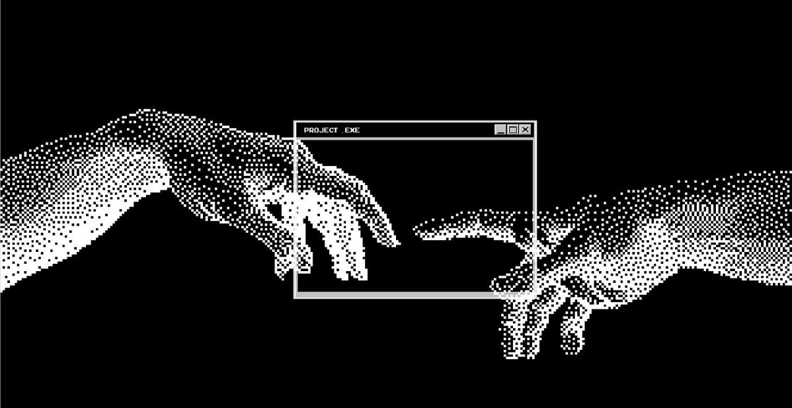

<!-- Banner no topo: coloque sua imagem em /assets/banner.png (ou use um link) -->

  

<h1 align="center">Hi 👋, Imma Dev Black</h1>

<h3 align="center">FullStack Developer</h3>

  

  Building reliable fullstack systems with clean architecture and scalable solutions.

---

## 🚀 About Me

<table>
<tr>
<td width="60%" valign="top">

Julio Perdigao - Dev Black, Here — a final-year Computer Engineering student focused on backend development.

I enjoy building scalable, production-ready APIs with Python and continuously improving my understanding of real-world backend systems.

Currently, I'm learning **FastAPI, PostgreSQL, SQLAlchemy, Docker, and Redis**, while sharpening my problem-solving skills through **Data Structures & Algorithms**.

My goal is simple: write clean code, build reliable software, and grow into a software engineer who creates systems that last.

</td>
<td width="40%" align="center">
  
</td>
</tr>
</table>

---

## 🤝 Connect

  
  
  

---

## 💻 Tech Stack

  
   
  

---

## 📊 GitHub Stats

  

---

## 📈 Activity Graph

  

